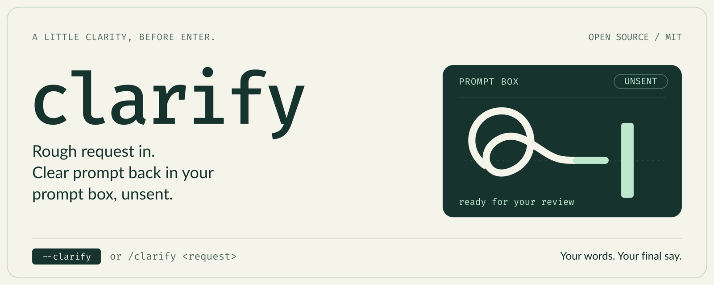
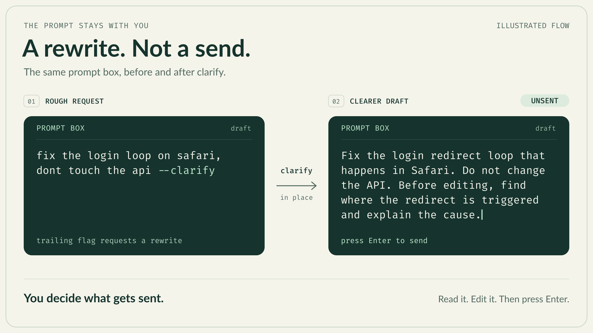

<p align="center"></p>

# clarify

A Claude Code plugin that turns a rough request into a clear prompt. It puts the rewrite back in your prompt box **without sending it**, so you read it, edit it, and press Enter yourself.

End any prompt with `--clarify`:

```
fix the login loop on safari, dont touch the api --clarify
```

Your prompt box then holds something like this, unsent:

```
Fix the login redirect loop that happens in Safari. Do not change the API.
Before editing, find where the redirect is triggered and explain the cause.
```

<p align="center"></p>

## Real examples

These are unedited outputs from the default model (`sonnet`), recorded on 2026-10-20. Rewrites differ a little from run to run, and you can edit any of them before sending.

<details open>
<summary><b>A slow export</b></summary>

**Before**

```
/clarify the export button on the reports page is slow when theres lots of rows, make it faster but dont change the csv format
```

**After** (in your prompt box, unsent)

```
Investigate and fix the slow export on the reports page. When a report has many rows, clicking the export button takes too long. Make it noticeably faster without changing the CSV output.

Requirements:
- Keep the CSV format exactly as it is today: same columns, column order, headers, delimiters, quoting/escaping, encoding, and row ordering. A file exported after your change should be byte-for-byte identical to one exported before it for the same data.
- Find the cause of the slowness first (for example, inefficient queries, loading all rows into memory, row-by-row processing, or blocking the request or UI) and base the fix on what you find, not on guesses.
- Limit changes to what is needed for export performance. Do not refactor unrelated parts of the reports page.

Deliverables:
- A short explanation of the root cause and the changes you made.
- A before/after comparison on a large dataset, using a rough timing or whatever measurement is practical.
- Confirmation that the CSV output is unchanged, such as a diff of exports from before and after the change, or existing or new tests.

If the fix would require a behavior change visible to users (such as moving the export to a background job with a download link), tell me before implementing it rather than assuming it is acceptable.
```

</details>

<details>
<summary><b>A one-line rename</b></summary>

**Before**

```
/clarify rename getUser to fetchUser everywhere
```

**After**

```
Rename the function `getUser` to `fetchUser` everywhere in the codebase.

Requirements:
- Update the function definition and every call site, import, export, re-export, type reference, and mention in comments, docs, and tests.
- Match whole identifiers only. Do not alter similarly named symbols such as `getUserById` or `getUsers`.
- Check for non-obvious usages, such as string references, mocks, and dynamic access, and update them if they clearly refer to this function.
- If renaming would conflict with an existing `fetchUser` symbol, stop and report the conflict rather than overwriting it.
- Do not change any behavior beyond the rename.

When finished, run the project's build, type-check, and tests if available, and summarize what changed and any places you were unsure about.
```

</details>

<details>
<summary><b>A flaky test, in Portuguese (it keeps your language)</b></summary>

**Before**

```
/clarify o teste de login ta quebrando no CI as vezes, descobre pq e conserta sem desligar o teste
```

**After**

```
O teste de login está falhando de forma intermitente (flaky) no CI. Investigue a causa raiz e corrija o problema, sem desativar, pular ou remover o teste.

O que fazer:
1. Localize o teste de login e o histórico de falhas no CI (logs de execuções recentes que falharam e que passaram) para identificar o padrão: em quais condições ele falha, qual é a mensagem de erro e em qual etapa do teste.
2. Levante hipóteses comuns para falhas intermitentes e verifique cada uma com evidências: condições de corrida ou esperas insuficientes (timeouts, elementos ainda não carregados), dependência de ordem de execução ou de estado compartilhado entre testes, dados de teste ou sessões/cookies que não são limpos, dependência de serviços externos ou rede, diferenças de ambiente entre local e CI (tempo, recursos, variáveis de ambiente, fuso horário), e execução paralela.
3. Reproduza a falha, localmente ou repetindo o teste várias vezes, sempre que possível, para confirmar a causa antes de corrigir.
4. Corrija a causa raiz (por exemplo, substituindo sleeps fixos por esperas explícitas condicionais, isolando o estado, ou tornando os dados determinísticos), em vez de mascarar o sintoma com retries ou aumentos arbitrários de timeout. Se um retry ou ajuste de timeout for realmente justificável, explique o motivo.
5. Valide a correção rodando o teste repetidamente (por exemplo, dezenas de vezes) e, se possível, no CI, confirmando que ele deixou de falhar.

Restrições:
- Não desligue, pule, marque como ignorado nem remova o teste, nem enfraqueça suas asserções para fazê-lo passar.
- Mantenha as mudanças restritas ao necessário para resolver o problema.

Ao final, entregue um resumo com: a causa raiz identificada e as evidências, as alterações feitas e como a correção foi validada. Se não for possível determinar a causa com certeza, diga isso explicitamente e indique o que ainda falta investigar.
```

</details>

## Install

At the prompt of a Claude Code terminal session:

```
/plugin install clarify --marketplace luchasarie/claude-clarify
```

Answer `y` to add the marketplace, then pick a scope (user scope makes it work in every session). The command works right away, with no restart.

From a shell:

```
claude plugin install clarify --marketplace luchasarie/claude-clarify
```

In the desktop app, where `/plugin` doesn't run: click **+** next to the prompt box, then **Plugins**, **Add marketplace** with `luchasarie/claude-clarify`, then **Add plugin**.

**Requirements:** a Claude Code build that supports plugin hooks modules (mods). It was tested on Claude Code 2.1.305. The mod API is in early access and can change between releases, so if it stops loading after a Claude Code update, please open an issue.

## Usage

| You type | What happens |
| --- | --- |
| `<request> --clarify` (or `-clarify`) | The prompt isn't sent. The rewrite replaces it in the prompt box. |
| `/clarify <request>` | Same result, as a slash command. |

Press Enter to send the rewrite, or edit it first. If you change your mind, just clear the box.

The marker only counts when it's the **last word** of the prompt. These are left alone and sent as normal:

- `explain the --clarify flag` (the marker isn't at the end)
- slash commands and `!` shell commands, such as `/review --clarify`
- a marker inside an open code fence or an open double quote

If the rewrite fails (timeout, API error, empty reply), your original draft goes back in the prompt box. If you've started typing something new in the meantime, the plugin doesn't overwrite it: the rewrite is copied to your clipboard instead.

## Configuration

One option: **model**, the model that does the rewrite. It can be `haiku`, `sonnet` (default) or `opus`. You set it when you install. To change it later, use the plugin's row in the config menu, or run:

```
claude plugin configure clarify
```

Haiku is the fastest and cheapest.

## Privacy and cost

- Your request goes to the model through your own Claude Code session, with your account's credentials. It counts toward your usage like any other request.
- The plugin sends nothing anywhere else, stores nothing, and has no telemetry.
- The request is sent as a JSON field with instructions to rewrite it and never act on it. Each rewrite is capped at 1,200 output tokens with a 30-second timeout.

## How it works

Everything lives in one file, [`hooks/register.ts`](hooks/register.ts):

- A `prompt.submit` hook spots a trailing `--clarify`. It drops the submission, so nothing reaches the conversation, and rewrites the text with `$.model.complete`.
- The rewrite goes into the prompt box with `$.prompt.fill`, but only if the box still holds your draft or is empty.
- `/clarify` is a registered command that runs the same rewrite.

The system prompt tells the model to keep your language, names, paths, commands and constraints, and to keep small requests small. If something important is ambiguous, it asks a short question in the rewrite instead of making something up.

## Uninstall

```
claude plugin uninstall clarify
```

## Development

```
git clone https://github.com/luchasarie/claude-clarify
cd claude-clarify
claude --plugin-dir .            # run a session with the mod loaded
claude plugin validate .         # manifest and hooks checks
claude plugin test .             # runs tests/*.test.ts
```

Type definitions are generated into `.claude-plugin/types/` the first time Claude Code loads the plugin (this folder is git-ignored). After that, `npx tsc -p .` type-checks the plugin.

## Acknowledgements

The idea, rewriting a draft before sending it and handing it back for review, comes from [pi-clarify](https://github.com/dodo-reach/pi-clarify) by dodo-reach. This is an independent implementation for Claude Code.

## License

[MIT](LICENSE)
